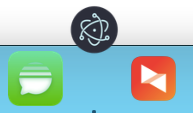
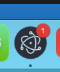
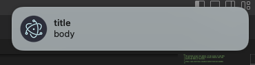
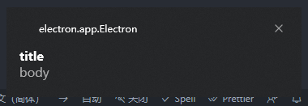
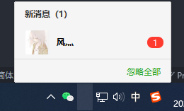

# 面试 QA

本文根据 Electron 跨平台 PC 客户端岗位 JD 整理面试高频 QA，覆盖项目经验、核心机制、双平台适配、打包发版、性能优化与问题排查。

## 1. [进程间通信](https://www.electronjs.org/zh/docs/latest/tutorial/ipc)

| 通信方式                                | 适用场景                   | 注意事项                   |
| --------------------------------------- | -------------------------- | -------------------------- |
| `ipcRenderer.send` / `ipcMain.on`       | 单向通知、无需返回值的事件 | 渲染器进程到主进程（单向） |
| `ipcRenderer.invoke` / `ipcMain.handle` | 请求-响应式调用            | 渲染器进程到主进程（双向） |
| `webContents.send` / `ipcRenderer.on`   | 主进程主动推送到页面       | 主进程到渲染器进程（单向） |
| `MessagePort`                           | 高频或复杂通道通信         | 渲染器进程到渲染器进程     |

Electron 的 IPC 实现使用 HTML 标准的 结构化克隆算法 来序列化进程之间传递的对象，这意味着只有某些类型的对象可以通过 IPC 通道传递。
无法使用结构化克隆序列化：

- DOM 对象
- Node.js 中由 C++ 类支持的对象（例如 process.env，Stream 的一些成员）
- Electron 中由 C++ 类支持的对象（例如 WebContents、BrowserWindow 和 WebFrame）

## 安全

- 设置 `nodeIntegration: false` 禁止渲染进程直接调用 Node.js API，降低 XSS 被用来读写本地文件、执行系统命令的风险。
- 设置 `contextIsolation: true` 启用上下文隔离。隔离页面与 preload 的 JavaScript 上下文。
- 设置 `sandbox: true` 渲染进程在 Chromium 的沙盒中运行，限制渲染进程直接访问系统资源。沙盒中的 preload 只能使用部分 Node.js 和 Electron API。
- 在 preload 中通过 `contextBridge` 只向页面暴露必要的业务接口。
- 主进程处理 IPC 请求前，先校验发送方和参数。
- 调用 `shell.openExternal` 前，先确认链接的协议和域名都在白名单内，避免任意协议调用。
- 保持 `webSecurity` 开启，让同源策略生效。需要拦截或调整特定请求时，在主进程通过对应 `Session.webRequest` 处理，并限定允许的请求来源和目标 URL。

## 3. 主进程和渲染进程分别负责什么？

一个 Electron 应用实例只有一个主进程，可以有多个渲染进程。

**主进程**是应用的入口，负责管理应用的启动和退出，以及窗口、菜单、托盘等原生功能。它运行在 Node.js 环境中，可以调用 Electron 和操作系统提供的 API，通过 IPC 和渲染进程通信。

**preload** 是在渲染进程里先于页面脚本执行的**预加载脚本**。

- 开启上下文隔离后，通过 `contextBridge.exposeInMainWorld` 只向页面暴露必要的业务接口。通过 IPC 交给主进程处理。
- 默认启用沙盒时，preload 只能访问部分 Node.js 和 Electron API。

**渲染进程**负责运行 Chromium 中的网页，页面调用 preload 暴露的接口和主进程通信。

## 主进程和渲染进程如何调试？

渲染进程通过 DevTools 调试，普通 Web 页面一样。

- 创建 `BrowserWindow` 时，`webPreferences.devTools` 默认为 `true`，设为 `false` 后无法打开 DevTools 开发者工具。
- 开发环境默认调用 `win.webContents.openDevTools()` 打开，生产环境需要调试时，由渲染进程通过 IPC 通知主进程打开。
- 使用 `electron-devtools-installer` 安装 vue / react DevTools 扩展

主进程在启动时加上 `--inspect` 或者 `--inspect-brk` 开启调试端口，再用 VS Code 或 Chrome 连接并打断点。

- `--inspect` 开启调试端口，程序正常运行。适合启动后调试，比如点击按钮触发 IPC。
- `--inspect-brk` 开启调试端口，让在执行第一行 JavaScript 前暂停，连接调试器后再继续运行，适合排查启动阶段的问题。

::: details 参考资料

- [Electron 调试应用](https://www.electronjs.org/zh/docs/latest/tutorial/application-debugging)
- [Electron 调试主进程](https://www.electronjs.org/zh/docs/latest/tutorial/debugging-main-process)
- [WebPreferences 配置](https://www.electronjs.org/zh/docs/latest/api/structures/web-preferences)
  :::

## 生产日志如何设计

- 在主进程用 Winston 写本地日志，统一日志格式，为每条日志补充时间和日志级别。日志文件按天、文件大小切分。
- 渲染进程代理 `console` 方法，保留原有的控制台输出，同时调用 preload 暴露的日志接口，通过 IPC 把日志发给主进程写入。

普通日志按时间顺序追加到同一份流水日志，系统监控这类日志单独记录。业务日志尽量记录用户操作、流程走到了哪一步，以及执行结果和异常信息等内容。这样排查问题时，可以沿着时间线还原操作过程，定位故障出在哪一步。

## 崩溃报告和错误收集

第三方库：Sentry

主进程：

- crashReporter 收集原生崩溃报告，上传到服务端
- process.on('uncaughtException') 捕获未处理的 JavaScript 异常
- process.on('unhandledRejection') 捕获未处理的 Promise 拒绝
- app.on('render-process-gone') 监听渲染进程异常退出

渲染进程：...

## 如何实现无边框窗口？

- 在主进程创建 `BrowserWindow` 时设置 `frame: false` 创建无边框窗口，去掉系统标题栏和窗口按钮，再由渲染进程绘制自定义标题栏。
- **自定义拖拽** 给标题栏设置 `app-region: drag` 标记为可拖拽，让用户能拖动窗口。标题栏里的按钮等可交互元素设为 `app-region: no-drag`，标记为不可拖拽保留点击能力。
- 在 MacOS上，设置 `titleBarStyle: 'hidden'` 隐藏系统标题栏，保留窗口左上角的红绿灯控件。通过 `trafficLightPosition: { x, y }` 调整红绿灯的位置
- **实现窗口按钮。** 页面通过 preload 暴露的接口发 IPC 请求，由主进程操作对应窗口。
  - 最小化 `minimize()`
  - 关闭 `close()`
  - 最大化按钮根据 `isMaximized()` 在 `maximize()` 和 `unmaximize()` 之间切换。

- [Electron 自定义窗口](https://www.electronjs.org/zh/docs/latest/tutorial/window-customization)

## 系统托盘

- **创建托盘。** 我会在主进程等 `app.whenReady()` 完成后，用 `new Tray(icon)` 创建托盘，并保留实例引用，避免被垃圾回收。Windows 优先用 `.ico` 图标，macOS 用模板图标适配浅色和深色菜单栏。
- **配置菜单。** 用 `Menu.buildFromTemplate()` 创建「显示主窗口」「退出」等菜单项，再通过 `tray.setContextMenu()` 绑定到托盘。
- **图标闪烁。** 有消息需要提醒时，可以用定时器调用 `tray.setImage()`，在正常图标和透明图标之间交替切换。
- **macOS 显示文字。** 用 `tray.setTitle()` 在菜单栏的托盘图标旁显示文字，比如未读消息数。

  
  

- **任务栏闪烁。** Windows 上，主窗口在后台时可以调用 `win.flashFrame(true)`，让任务栏里的窗口按钮闪烁。窗口重新获得焦点后调用 `win.flashFrame(false)` 停止闪烁。macOS 上对应的效果是 Dock 图标跳动。

  

    
    
  

- **macOS Dock 角标。** 用 `app.dock.setBadge(text)` 在程序坞的应用图标上显示未读数，传空字符串清除角标。显示角标需要应用拥有系统通知权限。

  

- **系统通知。** 主窗口在后台时，可以使用 `Notification` 弹出通知。用户点击通知后，通过 preload 和 IPC 让主进程显示并聚焦主窗口。

  

    
    
  

- **Windows 托盘悬浮框。** 鼠标移到托盘图标上时，用 `tray.getBounds()` 取到图标位置，在旁边显示一个无边框 `BrowserWindow`

  

参考资料见

- [Tray API](https://www.electronjs.org/zh/docs/latest/api/tray)
- [窗口闪烁](https://www.electronjs.org/docs/latest/api/browser-window#winflashframeflag)
- [Dock 角标](https://www.electronjs.org/docs/latest/api/dock#docksetbadgetext-macos)
- [系统通知](https://www.electronjs.org/docs/latest/tutorial/notifications)

## 定时 / 计划任务

- **应用内定时任务:** `node-cron` 按日历规则和时区触发
- **系统级计划任务:** Windows 任务计划程序 `schtasks`、macOS launchd、Linux systemd.timer
