# Vite 动态修改 base

本文说明 qiankun 场景下子应用静态资源（图片、字体、JS chunk、CSS）路径失效的根因，以及本项目的完整解决方案。

## 为什么子应用加载的资源会 404？

::: info 入口 JS / CSS 的地址补全
qiankun 借助 `import-html-entry` 解析子应用 HTML 时，会把收集到的外部样式 `href` 和外部脚本 `src` 中的资源地址，根据子应用入口 URL 补全为完整 URL 再请求资源。
:::

例如，子应用 `entry` 为 `http://localhost:8101/` 时：

| HTML 中收集到的资源                                | 补全后请求的地址                         |
| -------------------------------------------------- | ---------------------------------------- |
| `<link rel="stylesheet" href="/assets/index.css">` | `http://localhost:8101/assets/index.css` |
| `<script src="/assets/index.js"></script>`         | `http://localhost:8101/assets/index.js`  |

**Vite 构建产物中以下两类资源引用还需单独处理：**

1. **HTML 中的资源地址**：`<link rel="modulepreload">` 的 `href` 和内联脚本中的 `import()` 地址。
2. **异步 chunk 预加载**：动态 `import()` 触发时，Vite 为 JS / CSS chunk 创建的 `modulepreload` / `stylesheet` 链接地址。

::: tip 两类地址受同一个 base 配置影响
使用 Vite 默认的 `base: '/'` 构建时，这两类地址会生成 `/assets/...` 这样的绝对 URL 路径名（下文简称根路径），其中不包含 origin。它们直接用于主应用页面的链接或内联脚本时，会按主应用的 origin（协议、主机及端口）解析，导致资源 404。
:::

### HTML 中的资源地址

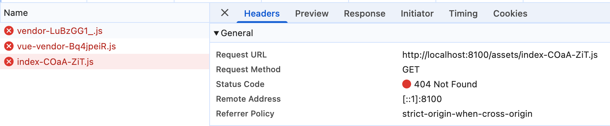

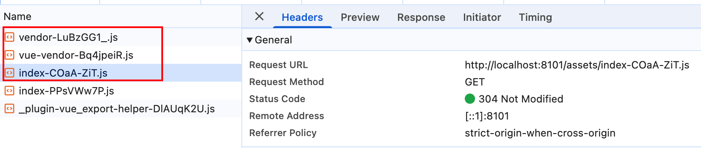

以启用 `manualChunks` 拆包的 `index.html` 为例，模板里会同时出现三种需要处理的根路径资源：

<!-- prettier-ignore -->
```html [apps/vue3-history/dist/index.html]
<script crossorigin="">
  import('/assets/index-COaA-ZiT.js').finally(() => { // [!code focus]
    const qiankunLifeCycle =
      window.moudleQiankunAppLifeCycles &&
      window.moudleQiankunAppLifeCycles['vue3-history']
    if (qiankunLifeCycle) {
      window.proxy.vitemount((props) => qiankunLifeCycle.mount(props))
      window.proxy.viteunmount((props) => qiankunLifeCycle.unmount(props))
      window.proxy.vitebootstrap(() => qiankunLifeCycle.bootstrap())
      window.proxy.viteupdate((props) => qiankunLifeCycle.update(props))
    }
  })
</script>
<link rel="modulepreload" crossorigin="" href="/assets/vendor-LuBzGG1_.js"> <!-- [!code focus] -->
<link rel="modulepreload" crossorigin="" href="/assets/vue-vendor-Bq4jpeiR.js"> <!-- [!code focus] -->
<link rel="stylesheet" crossorigin="" href="/assets/index-KlKjbc8W.css"> <!-- [!code focus] -->
```

| 模板中的形式                                    | 来自构建的哪一步                        |
| ----------------------------------------------- | --------------------------------------- |
| 内联 `<script>` 里的 `import('/assets/...')`    | `vite-plugin-qiankun` 注入的入口脚本    |
| `<link rel="modulepreload" href="/assets/...">` | `manualChunks` 拆包后 Vite 写入的预加载 |
| `<link rel="stylesheet" href="/assets/...">`    | Vite 构建产出的入口 CSS 静态声明        |

解决方案：主应用通过 qiankun 的 `getTemplate` 钩子拿到模板后，把所有 `/assets/...` 统一替换成 `${entry}/assets/...` 的子应用完成 URL。

### 异步 chunk 预加载

- 触发动态 `import()` 时，Vite 的预加载辅助函数会为异步 chunk 及其公共 JS 依赖动态创建 `<link rel="modulepreload">` 标签并插入 `document.head`（已存在的链接会复用），提前并行发起请求，减少逐层发现依赖产生的网络等待。详见 [Vite 异步 Chunk 加载优化](https://cn.vitejs.dev/guide/features#async-chunk-loading-optimization)。

- 启用 CSS 代码分割时，异步 chunk 的 CSS 会通过 `<link rel="stylesheet">` 加载。详见 [Vite CSS 代码分割](https://cn.vitejs.dev/guide/features#css-code-splitting)。

#### 预加载地址与实际 import() 地址的区别

以默认 `base: '/'` 构建的产物为例，动态导入被包装成预加载辅助函数 `i` 的调用：

```js [apps/vue3-history/dist/assets/index-By4YD9se.js]
i(() => import('./LazyDetail-DfgodzIU.js'), __vite__mapDeps([0, 1, 2, 3]))
```


`__vite__mapDeps` 从依赖表中取出 `assets/LazyDetail-DfgodzIU.js`、`assets/LazyDetail-CQIUOEMn.css` 等地址。辅助函数按 `base: '/'` 为它们添加 `/` 前缀，再创建 JS 的 `modulepreload` 和 CSS 的 `stylesheet` 链接。这些根路径链接插入主应用页面后，会请求到主应用 origin。

而实际的 `import('./LazyDetail-DfgodzIU.js')` 使用 `./` 相对路径，以当前模块自身的 URL 为基准。假设主应用为 `http://localhost:8100/`，入口模块加载自 `http://localhost:8101/assets/index-By4YD9se.js`，则两类请求分别指向：

```text
JS 预加载：http://localhost:8100/assets/LazyDetail-DfgodzIU.js
CSS 加载：http://localhost:8100/assets/LazyDetail-CQIUOEMn.css
实际 import()：http://localhost:8101/assets/LazyDetail-DfgodzIU.js
```

因此，即使实际 `import()` 的地址正确，预加载链接因指向主应用而返回 404；入口 HTML 的路径补全不会处理这部分运行时创建的链接。

## 完整的 URL

以 HTTP(S) 资源地址为例，需要区分以下三种形式，详见 [Vite base 配置](https://vite.dev/config/shared-options#base)：

| 形式            | 示例                         | 含义                                                  |
| --------------- | ---------------------------- | ----------------------------------------------------- |
| 完整的 URL      | `http://localhost:8101/foo/` | 包含协议、主机（含可选端口）和路径                    |
| 绝对 URL 路径名 | `/foo/`                      | 只指定从根目录起算的路径，仍需结合解析上下文的 origin |
| 相对路径        | `./foo/`                     | 按基准 URL 所在目录解析                               |

生产构建时，将子应用 `base` 配置为完整的 URL，可以让生成的资源 URL 固定指向子应用资源服务器：

```ts [apps/vue3-history/vite.config.ts]
export default defineConfig({
  base: 'http://localhost:8101', // 简单，但有局限
})
```

Vite 在开发模式下会忽略完整 URL 中的 origin，仅使用其中的路径名；开发资源的来源地址需通过 `server.origin` 指定。

::: details Webpack 对应的静态配置 `output.publicPath`
Webpack 可以通过 `output.publicPath` 指定完整的资源 URL 前缀：

```js [webpack.config.js]
export default {
  output: {
    publicPath: 'http://localhost:8101/',
  },
}
```

:::

这种方式的问题：

- 开发、测试、生产环境的域名不同，需要构建时区分
- 子应用部署域名变更时必须重新构建
- <span style="color: var(--vp-c-danger-1); font-weight: bold;">同一份构建产物无法在不同主应用环境下复用</span>

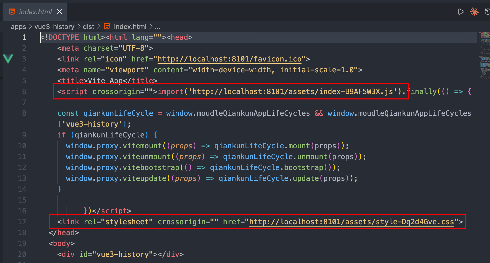

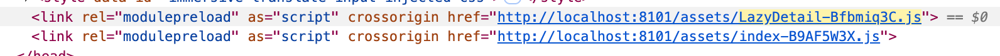

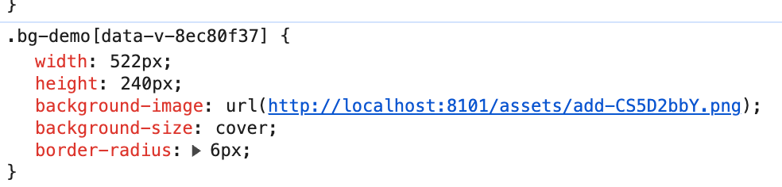

## 运行时动态路径

为了让灰度和生产复用同一份产物，资源的最终 URL 在加载时根据子应用 `entry` 或资源所属文件的 URL 确定。Vite 通过构建时配置相对 `base` 实现这一点，运行时按实际文件地址解析资源，无需动态修改 `base` 配置值。

::: details Webpack 的运行时 publicPath
Webpack 子应用可以通过 `__webpack_public_path__` 在运行时设置资源 URL 前缀。**开启 Proxy 沙箱时，qiankun 实际将 `__INJECTED_PUBLIC_PATH_BY_QIANKUN__` 注入子应用的沙箱代理对象**，详见 [qiankun 的注入实现](https://github.com/umijs/qiankun/blob/v2.10.16/src/addons/runtimePublicPath.ts)。执行子应用脚本时，该代理会被暴露为原生 `window` 上的 `proxy`，因此从原生 `window` 上下文访问时，对应的是 `window.proxy.__INJECTED_PUBLIC_PATH_BY_QIANKUN__`。

经过沙箱包装的 Webpack 代码中，`window` 已指向该代理对象，所以仍通过 `window.__INJECTED_PUBLIC_PATH_BY_QIANKUN__` 读取；本项目 Vite 的原生 ESM 代码中的 `window` 则是浏览器原生对象，需要通过 `window.proxy` 访问沙箱属性。两种读取方式的区别在于代码执行上下文，详见 [import-html-entry 的脚本执行包装](https://github.com/kuitos/import-html-entry/blob/master/src/index.js)。下面是沙箱内 Webpack 子应用的写法，**同时适用于开发环境和生产环境**：

```js [src/public-path.js]
if (window.__POWERED_BY_QIANKUN__) {
  __webpack_public_path__ = window.__INJECTED_PUBLIC_PATH_BY_QIANKUN__
}
```

路径初始化必须早于业务模块执行。不能只把赋值语句写在入口文件的静态 `import` 前面：静态导入的依赖模块仍可能先执行，提前计算出错误的资源 URL。将赋值放到独立模块，并首先导入该模块，才能保证正常业务依赖执行前完成初始化。详见 [Webpack 运行时 publicPath](https://webpack.js.org/guides/public-path/#on-the-fly)。
:::

### 主应用：HTML 模板补丁

主应用通过 qiankun 的 `getTemplate` 钩子，在加载子应用 HTML 时，将模板中 `./` 开头的资源路径按子应用入口 `entry` 补全为完整 URL。

改写效果示例：

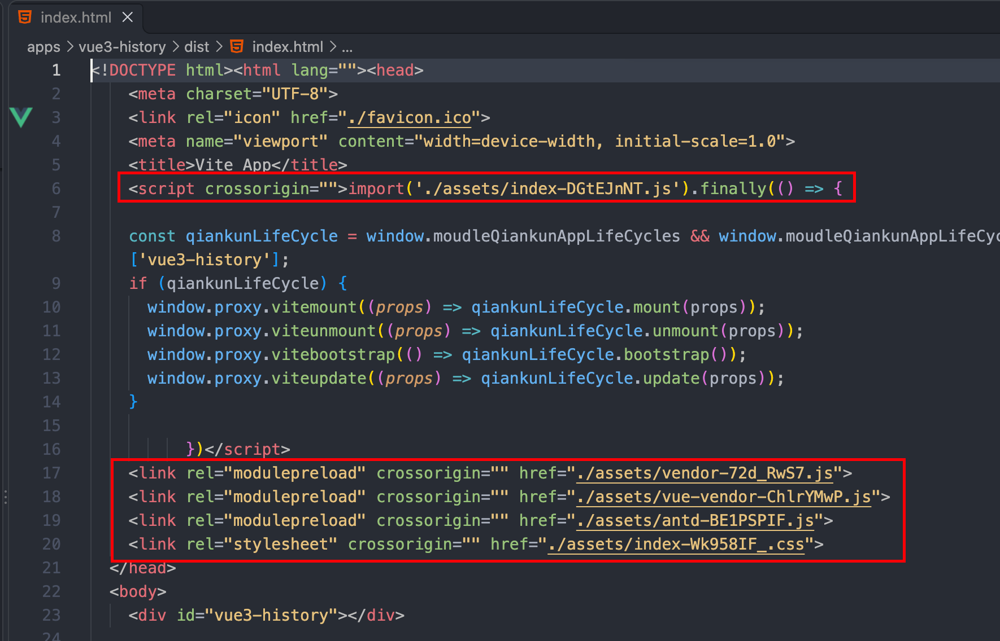

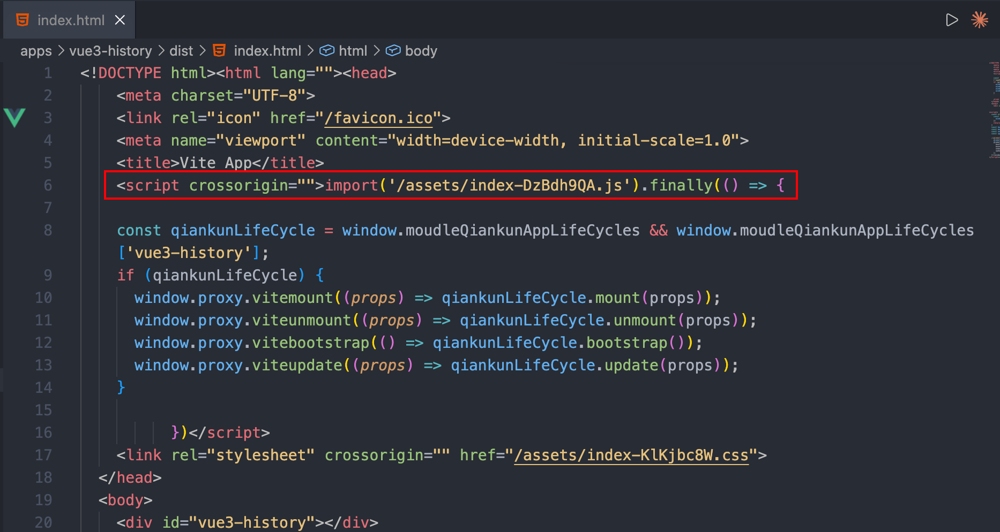

### 子应用：配置 base

子应用通过 `base: './'` 生成相对资源路径，开发时通过 `server.origin` 指定资源来源：

```ts [packages/vite-config/src/qiankun.ts]
return {
  base: './',
  server: {
    origin: `http://localhost:${port}`,
  },
}
```

`base: './'` 使 Vite 在生产构建时，将经其处理的资源引用生成为相对于所属文件的 URL，详见 [Vite 相对基础路径](https://vite.dev/guide/build#relative-base)。同一份产物部署到不同域名或子目录后，只要目录结构保持一致，就可以按实际文件地址加载资源。

生产构建的入口模块从正确的子应用 URL 加载后，模块内部的相对静态导入和动态 `import()` 都以该模块 URL 为基准。对于异步 chunk 的预加载依赖，Vite 在相对 base 下会把导入模块的 `import.meta.url` 作为基准，使用 `new URL(dep, importerUrl).href` 计算地址，详见 [Vite build.modulePreload](https://vite.dev/config/build-options#build-modulepreload)。

例如，入口模块位于 `http://localhost:8101/assets/index.js` 时：

| 资源加载方式  | 相对地址                    | 最终请求地址                                  |
| ------------- | --------------------------- | --------------------------------------------- |
| 实际动态导入  | `import('./LazyDetail.js')` | `http://localhost:8101/assets/LazyDetail.js`  |
| JS 预加载依赖 | `./LazyDetail.js`           | `http://localhost:8101/assets/LazyDetail.js`  |
| 异步 CSS 加载 | `./LazyDetail.css`          | `http://localhost:8101/assets/LazyDetail.css` |

实际导入与预加载都使用模块 URL 解析，不会再因为链接插入主应用 `document.head` 而转向主应用 origin。主应用只需补全入口 HTML，不必为每个 JS chunk 计算资源域名。

::: tip 开发模式仍需 server.origin
开发模式下，Vite 会将 `base: './'` 按 `/` 处理，不会让开发资源也变成 `./` 路径。`server.origin` 用于给开发时生成的资源 URL 添加子应用来源地址，避免注入主应用的 CSS 中 `/src/...` 被请求到主应用端口；它不影响生产构建产物。
:::

### 入口 CSS 文件中的 url()

#### CSS 内联后的相对路径

Vite 默认开启 [`build.cssCodeSplit`](https://cn.vitejs.dev/config/build-options#build-csscodesplit)，异步 chunk 关联的 CSS 会被单独提取，由 Vite 运行时（`__vitePreload`）在懒加载触发时动态创建 `<link rel="stylesheet">` 元素插入 `document.head`。**这类 CSS 始终以外链 `<link>` 形式加载，不经过 qiankun 的 fetch 钩子**。

::: tip 相对 base 保留异步 CSS 的资源来源
在 [运行时动态路径方案](#运行时动态路径) 中，Vite 根据发起导入的 JS 模块的 `import.meta.url` 计算异步 CSS 的完整 URL。CSS 以 `<link>` 形式从子应用加载，其中的相对 `url()` 再由浏览器按 CSS 文件 URL 解析，无需入口 CSS 拦截器介入。
:::

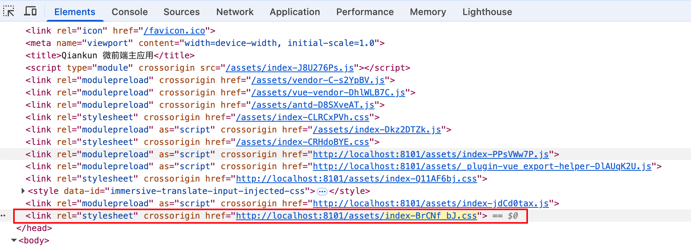

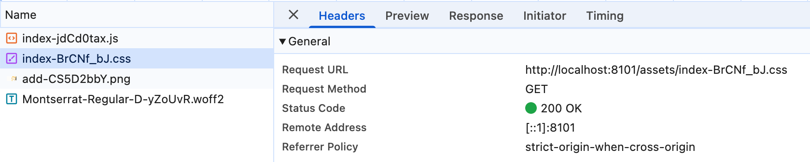

问题出在另一条路径——子应用初始 HTML 中**静态声明的** `<link rel="stylesheet">`（通常是全局样式、CSS 变量、字体等入口 CSS）由 `import-html-entry` 在解析 HTML 时主动 fetch，并将 CSS 文本**内联为 `<style>` 标签**注入主应用 `document`，这是 `import-html-entry` 加载入口样式的处理方式：

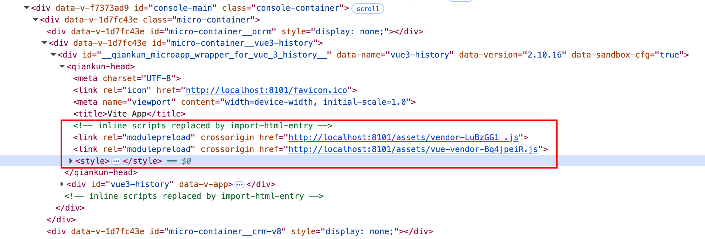

::: warning 内联 `<style>` 与外链 `<link>` 的 url() 解析差异

- **外链 `<link>`**：浏览器知道样式表的 origin，`url(...)` 相对于 CSS 文件地址解析 → 正确。
- **内联 `<style>`**：没有自身 URL，浏览器以**主应用页面 URL** 为基准，`url(...)` 变成主应用目录下的路径 → 404。

:::

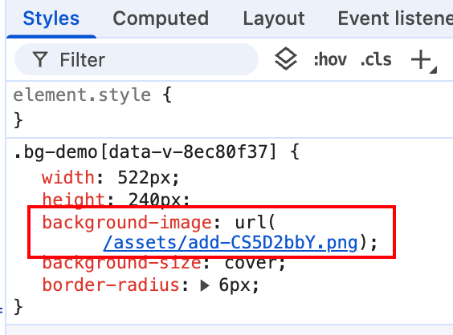

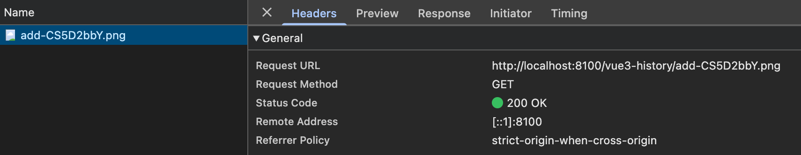

#### 解决方案：通过 qiankun fetch 拦截改写

通过配置 qiankun 的 `fetch` 钩子，拦截子应用初始 HTML 中静态 `<link rel="stylesheet">` 对应的 CSS 文件请求。拦截器在 CSS 文本被内联前，将 `url()` / `@import` 中 `./` 开头的地址按原 CSS 文件 URL 补全，保留样式表原有的资源解析基准。以下实现与提交 `3903107` 一致；主应用处于开发模式、请求不是字符串或地址不以 `.css` 结尾时，直接透传。

```ts [apps/main-app/src/utils/microApp/cssProcessor.ts]
export const cssFetchInterceptor: typeof window.fetch = (url, ...args) => {
  if (import.meta.env.DEV || typeof url !== 'string' || !url.endsWith('.css')) {
    return window.fetch(url, ...args)
  }

  return Promise.resolve({
    async text() {
      const res = await window.fetch(url, ...(args as [RequestInit?]))
      const css = await res.text()
      return replacePathInCSS(css, (path) => new URL(path, url).href)
    },
  } as unknown as Response)
}
```

`replacePathInCSS` 仅匹配以下语法中以 `./` 开头的资源地址：

| 模式                              | 示例                   |
| --------------------------------- | ---------------------- |
| `@import '...'` / `@import "..."` | `@import './font.css'` |
| `url('...')` / `url("...")`       | `url('./image.png')`   |
| `url(...)` 无引号                 | `url(./icon.svg)`      |

例如，CSS 文件地址为 `http://localhost:8101/assets/index.css` 时，`new URL('./add.png', url).href` 得到 `http://localhost:8101/assets/add.png`。`data:` URL、完整的 HTTP(S) URL、以 `/` 开头的绝对 URL 路径名及 `../` 等不以 `./` 开头的地址不参与替换，base64 图片因而可以保持原样。

::: tip 仅拦截 qiankun fetch 的 CSS，不影响异步 chunk
`configuration.fetch` 替换的是 `import-html-entry` 内部调用的 `fetch`，**只作用于 qiankun 主动拉取的资源**（初始 HTML 中静态声明的 `<link>`）。运行时由 `__vitePreload` 通过 DOM API 插入的异步 chunk CSS 不经过此钩子，不受影响。
:::

**为什么当前实现仍保留入口 CSS 拦截？**

CSS 是否进入入口文件取决于模块依赖和加载时机，不能仅凭 Vue 的 `scoped` 或 `module` 判断。首屏组件样式、全局背景图和字体样式都可能进入入口 CSS；只有归属于异步 chunk 的样式才随异步模块加载。

提交 `3903107` 在 `apps/vue3-history/src/assets/scss/index.scss` 中加入了两个入口 CSS 验证场景：

| 样式选择器                 | 资源形式                                             | 预期处理                       |
| -------------------------- | ---------------------------------------------------- | ------------------------------ |
| `.asset-path-test::before` | 外部图片 `add.png`，构建后为 `url(./add-<hash>.png)` | 内联前按入口 CSS 文件 URL 补全 |
| `.asset-path-test::after`  | base64 SVG 的 `data:` URL                            | 保持原样                       |

这些全局样式进入初始 HTML 引用的入口 CSS，图片路径确实需要在内联前处理。`base: './'` 保证构建产物使用相对路径，`cssFetchInterceptor` 则恢复内联前的解析基准，两者覆盖不同环节。

## ❓为什么不需要禁用 build.cssCodeSplit

::: info **过去的误判**：
生产环境中可以观察到子应用的 async chunk CSS 以 `<link>` 形式被插入主应用的 `head`，直觉上容易误判为"样式跑到主应用里了，会污染其他子应用"。

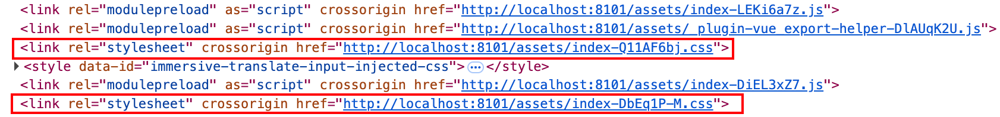

为了规避这个现象，早期配置了 `build.cssCodeSplit: false`，将所有样式合并进入口 CSS，再由 `cssFetchInterceptor` 统一处理路径。**但这个前提判断是错的。**
:::

理解这一点，需要知道 **qiankun 只劫持初始 HTML 中静态声明的资源**：

- `import-html-entry` 解析子应用 HTML 时，将静态 `<link rel="stylesheet">` 通过 `fetch` 钩子拉取并**内联为 `<style>`**，`url()` 路径由此失去原始 origin（需要 `cssFetchInterceptor` 改写）
- `__vitePreload` 在运行时以 `document.createElement + appendChild` 动态插入的 async chunk CSS，**完全绕过 qiankun 的 fetch 钩子**，以原生 `<link>` 加载

| CSS 来源                                                  | 是否经过<br/> qiankun 劫持 | 加载结果                                   | `url()` 解析基准      |
| --------------------------------------------------------- | -------------------------- | ------------------------------------------ | --------------------- |
| HTML 中静态声明的<br/> `<link rel="stylesheet">`          | ✅ 是                      | `import-html-entry` <br/>内联为 `<style>`  | **主应用页面 URL** ❌ |
| Vite 异步 chunk JS/CSS<br/>（`__vitePreload` 运行时注入） | ❌ 否                      | `<link>` / `<script>` <br/>直接插入 `head` | **文件自身 URL** ✅   |

**无法劫持，也不需要处理**，原因在于两点：

1. **正确解析 url() 路径**：async chunk CSS 以 `<link href="绝对URL">` 加载（相对 base 下，`href` 由 Vite 按导入模块的 `import.meta.url` 解析），浏览器对 `<link>` 样式表内 `url()` 相对于 CSS 文件自身 URL 解析，与主应用页面 URL 无关。
2. **样式不会污染**：Vue `<style scoped>` 在编译期为每条规则附加唯一的 `[data-v-xxxxxxxx]` 属性选择器，作用域锁定在组件内部，即使 `<link>` 插入主应用 `head`，规则也不会泄漏到其他组件或子应用。

::: warning 禁用 cssCodeSplit 的实际代价
`cssCodeSplit: false` 把 async chunk CSS 强行塞进入口 `<link>`，使其落入 qiankun 劫持范围，反而制造了本不存在的问题：

- **首屏体积增大**：（入口 CSS 体积暴增）所有页面的样式一次性全量下载，即使大多数路由从未访问
- **抹除 Vite code splitting 的收益**：async chunk 的按需加载优势完全消失
- **与 cssFetchInterceptor 强耦合**：CSS 合并进入口后必须依赖拦截器改写路径，两者绑定在一起，任一失效均会导致样式资源 404
  :::

## ❓子应用卸载后 link 标签残留

子应用 unmount 后，主应用 `head` 中会保留 `__vitePreload` 运行时插入的 `<link>` 标签：

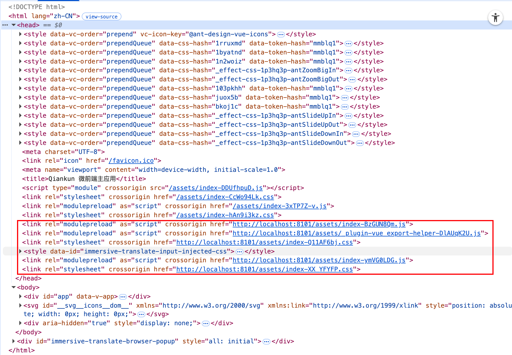

**为什么 qiankun 无法移除它们**

qiankun 沙箱的职责范围是 **JS 全局变量隔离**（window proxy）和 **`<style>` 标签的生命周期管理**（由 qiankun 自身注入的样式）。对于子应用代码在运行时通过 `document.head.appendChild` 插入的 `<link>` 元素，qiankun 不做追踪，unmount 时也不会清理。

**为什么残留没有影响**

| 标签                         | 残留影响                                                                                                                                    |
| ---------------------------- | ------------------------------------------------------------------------------------------------------------------------------------------- |
| `<link rel="modulepreload">` | 仅是浏览器预加载提示，不执行代码、不挂载组件，留在 `head` 完全惰性                                                                          |
| `<link rel="stylesheet">`    | CSS 规则全部带有 `[data-v-xxxxxxxx]` scoped 选择器，只匹配携带该属性的元素；子应用卸载后对应 DOM 节点已移除，CSS 规则无匹配目标，实际不生效 |

两类标签的 `href` 均为内容寻址的哈希文件名，若子应用再次挂载，浏览器直接命中缓存，不会产生额外网络请求。

## ❓Dev 环境 style 插入主应用 head（无需处理）

开发环境（`vite dev`）下，样式由 Vite HMR 客户端以 `<style data-vite-dev-id="...">` 的形式动态注入 `document.head`。在 qiankun 场景中看到 style 节点出现在主应用 `head`，属于 **Vite 的预期行为**，不是异常。

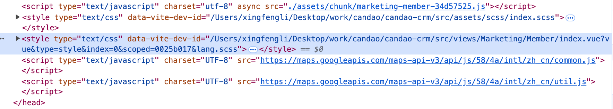

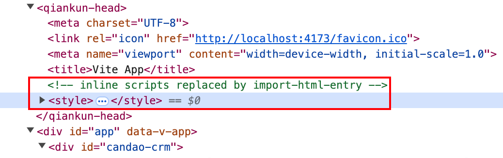

当前项目不需要对该现象做额外处理，原因是：

1. **仅发生在开发环境**：生产构建不会走这套 HMR 注入机制，线上行为由构建产物的 `<link>` / `chunk` 加载机制决定。
2. **路径不受影响**：开发环境通过 `server.origin` 提供正确资源来源；生产环境通过 `base: './'`、入口 HTML 补全和入口 CSS 拦截处理资源路径，关注点是资源 URL 正确性，而不是 style 节点位于哪个 `head`。
3. **样式污染风险可控**：业务样式以 Vue `scoped` 为主，规则带 `[data-v-xxxx]` 作用域；即使 style 节点位于主应用 `head`，也不会无边界扩散到其他子应用。

::: tip 什么时候才需要处理
只有在开发环境已经出现"可复现的样式串扰或覆盖"时，才需要针对具体样式来源做治理（例如全局 reset、第三方库全局样式），而不是因为"style 出现在主应用 head"这个现象本身去改加载机制。
:::

## 相关链接

- [Vite 相对基础路径](https://vite.dev/guide/build#relative-base)
- [Vite build.modulePreload](https://cn.vitejs.dev/config/build-options#build-modulepreload)
- [qiankun loadMicroApp — FrameworkConfiguration](https://qiankun.umijs.org/zh/api#loadmicroappapp-configuration)
- [import-html-entry fetch 钩子](https://github.com/kuitos/import-html-entry)
- [vite-plugin-qiankun：生产环境动态替换资源路径支持](https://github.com/tengmaoqing/vite-plugin-qiankun/issues/16)
- [qiankun issue：请求自动转换 CSS 中相对路径为完整链接](https://github.com/umijs/qiankun/issues/2014#issuecomment-1085552127)
- [qiankun issue：希望提供 CSS 后处理参数处理相对路径](https://github.com/umijs/qiankun/issues/981#issuecomment-714218539)
- [qiankun issue：子应用 CSS url() 相对路径加载失败](https://github.com/umijs/qiankun/issues/808#issuecomment-692652178)
